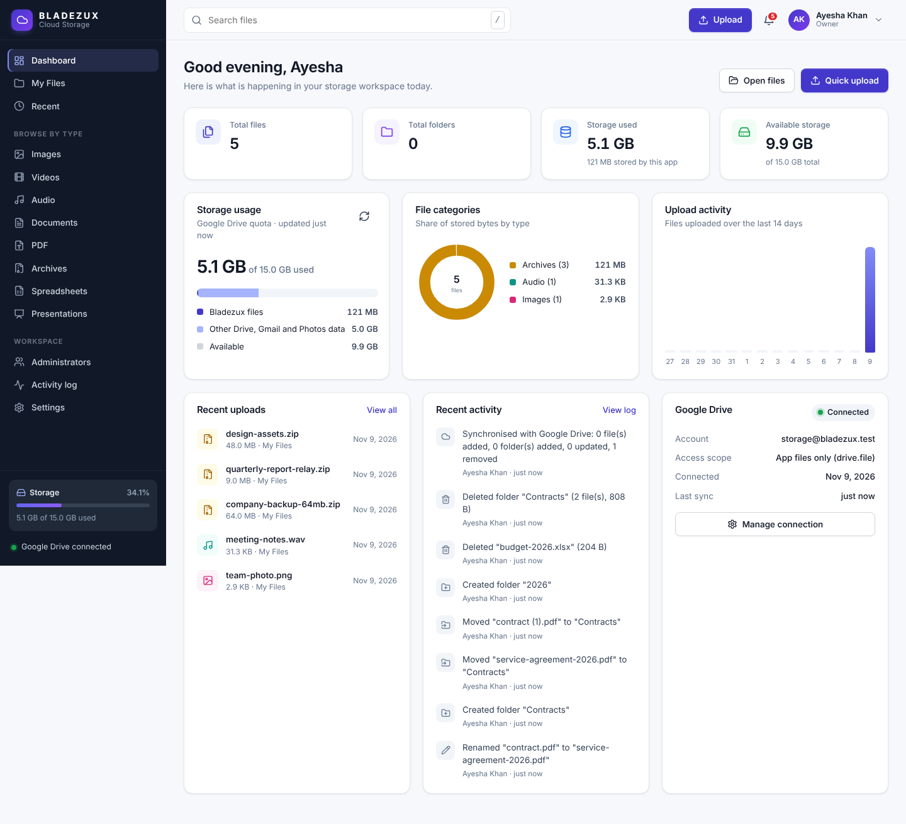

# Bladezux Cloud Storage

A private, self-hosted cloud storage web application for a company, built for **standard cPanel shared hosting**
(PHP 8.2+ and MySQL, no Node.js at runtime). Administrators upload, organise, preview, download and delete files.
The files themselves are stored in the company's **Google Drive** through the official Drive API v3 and OAuth 2.0.
They are never stored on the web server.



## Features

- **Large resumable uploads**: the browser uploads chunks directly to a Google Drive resumable session, so files
  never pass through PHP's upload handling. Includes a multi-file queue, drag and drop, progress, speed and ETA,
  pause/resume, retry, cancel, automatic recovery after network drops, resume after a page reload, duplicate-name
  handling (keep both, replace or skip) and validation. If the browser can't reach Google directly, the uploader
  falls back automatically to relaying the chunks through the server.
- **File manager**: grid and list views, nested folders, breadcrumbs, search, type filter, sorting, multi-select,
  bulk move, delete and download, drag-and-drop moves, context menus, keyboard shortcuts, thumbnails, previews
  (images, PDF, audio, video with seeking), file details, rename, and delete to the Drive trash.
- **Dashboard**: live totals, Drive quota usage, category chart, 14-day upload chart, recent uploads and recent
  activity, Drive status and quick upload.
- **Accounts**: one Owner plus invited Admins. Includes login, invite-only sign-up, forgot and reset password
  (hashed single-use links that expire after 30 minutes), profile, password change, session management and login
  history.
- **Email**: cPanel SMTP through PHPMailer. Sends branded emails for password resets, invitations, account changes
  and security notices, and has a test-email function.
- **Google Drive**: OAuth with PKCE and `state`, encrypted tokens, automatic token refresh, connection status,
  quota, a private app folder, sync, reconnect and disconnect.
- **Security**: PDO prepared statements, CSRF tokens, a strict Content Security Policy, hardened sessions, rate
  limiting, AES-256-GCM encryption for stored secrets, MIME and magic-byte checks, an extension blocklist, HTTPS
  enforcement, `.htaccess` hardening and a private config file kept outside `public_html`.
- **UI**: a responsive design for phones, tablets and desktops, light, dark and system themes, Lucide icons and
  the Inter font. Every asset is served locally, with no CDN.

## Package layout

```
storage/                 → upload to public_html/storage/
  app/                   PHP library, views, PHPMailer (denied by .htaccess)
  api/index.php          JSON API (file manager + uploader)
  assets/                CSS, JS, icon sprite, font
  install/               one-time web installer (delete after use)
  *.php                  pages: login, signup, dashboard, files, settings, admins, activity, download, thumb, oauth-callback
private/config.sample.php  configuration template (real config lives outside public_html)
database/install.sql     MySQL schema
docs/                    installation, Google, SMTP, configuration, security and testing guides
tests/                   end-to-end suite, mock Google Drive/OAuth server, SMTP sink
tools/                   icon sprite + ZIP build scripts
```

## Documentation

1. [cPanel deployment guide](docs/INSTALLATION.md)
2. [Google Drive API and OAuth setup](docs/GOOGLE_DRIVE_SETUP.md)
3. [SMTP configuration](docs/SMTP_SETUP.md)
4. [Configuration reference](docs/CONFIGURATION.md)
5. [Post-install security checklist](docs/SECURITY_CHECKLIST.md)
6. [Testing checklist](docs/TESTING_CHECKLIST.md) and [automated results](tests/RESULTS.md)

## Architecture of an upload

```
Browser ──(1) upload.init: name, size, first 4 KB──▶ PHP ──(2) create resumable session (OAuth token, Origin)──▶ Google Drive
Browser ◀────────────── session URI only ─────────── PHP
Browser ──(3) PUT chunk 0..n, Content-Range ─────────────────────────────────────────────────────────────▶ Google Drive
Browser ──(4) upload.complete ──▶ PHP ──(5) verify size + parent with Drive, record metadata in MySQL
           (fallback: chunk → upload.relay → PHP → same Drive session, one chunk at a time, nothing stored)
```

## Known limitations

These are stated plainly so nothing is assumed to work when it hasn't been verified:

- **Not yet run against live Google.** No Google credentials or mailbox were available while building this.
  Every flow was tested end to end against a mock server that implements the same OAuth and Drive v3 protocol
  (see [tests/RESULTS.md](tests/RESULTS.md), 75/75 checks passing, including a 1 GB upload). Run the manual
  acceptance test in [TESTING_CHECKLIST.md](docs/TESTING_CHECKLIST.md) on your server once after deployment.
- **Direct upload depends on CORS.** Direct browser-to-Drive uploads rely on Google returning CORS headers for a
  resumable session that was created with your site's `Origin`. If a browser or network blocks this, the app
  switches automatically to relay mode. Relay mode still works, but it uses your hosting bandwidth, and its chunk
  size is limited by `post_max_size`.
- **Downloads and previews stream through PHP**, because the files are private. Very long downloads depend on
  your host allowing long-running PHP requests. HTTP Range requests let browsers and download managers resume
  them.
- **Bulk download** starts one download per file. There is no server-side ZIP, which would mean pulling many
  gigabytes through shared hosting.
- **Folder uploads** (dropping a whole folder) aren't supported. Create the folder in the app, then upload its
  files into it.
- **Google's limits apply**: 5 TB per file, about 750 GB of uploads per user per day, upload sessions expire
  after about a week, and API rate quotas.
- **Delete** moves items to the Google Drive trash, where they can be recovered for 30 days. Nothing is erased
  permanently.
- With the default `drive.file` scope, **Sync with Drive** only sees files the app created. Use the full `drive`
  scope if people also add files to the folder directly in Google Drive.

## Licence notes

Bundled third-party code: PHPMailer (LGPL-2.1, `storage/app/vendor/phpmailer/LICENSE`), Lucide icons (ISC),
Inter font (SIL OFL 1.1).
