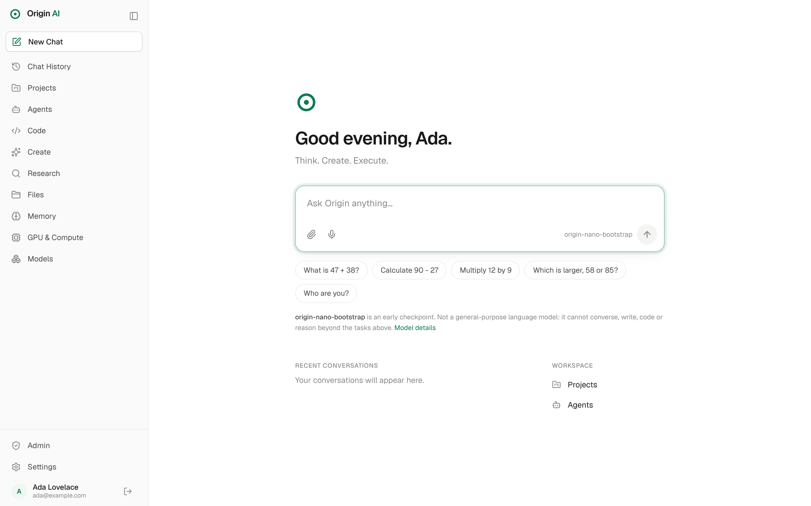

# Origin AI

**Your AI. Your Control.** — Think. Create. Execute.

Origin AI is an independent AI platform: its own tokenizer, its own
transformer, its own training and serving stack, and a clean chat-first
interface on top. No third-party AI API or pretrained weights are used at
runtime.



> **Where it stands (v0.1.0).** The foundation, chat product and model stack
> work end to end. The only trained model so far is a 1.9 M-parameter
> bootstrap checkpoint that does simple arithmetic (99.4 % on held-out
> problems). It is not a general assistant yet — that needs a GPU and a text
> corpus. See [DEVELOPMENT_STATUS.md](DEVELOPMENT_STATUS.md) for exactly what
> works and what does not.

## Quick start

Requirements: Python 3.10+, Node 20+. No GPU, database server or Docker needed.

```bash
cd origin-ai
make setup              # Python venv + Node dependencies
make bootstrap-model    # train the first model from random weights (~25 min on 4 CPU cores)
make dev                # API on :8000, web on :3000
```

Open http://localhost:3000 and create the owner account. Try
“What is 47 + 38?”.

You can skip `make bootstrap-model`; chat will then tell you no model is
available rather than answer.

## Layout

| Path | What |
|---|---|
| `core/` | Origin Core: tokenizer, model, training, evaluation, inference (`origin-core` CLI) |
| `services/api/` | FastAPI platform API |
| `apps/web/` | Next.js web app |
| `data/` | Runtime data: database, uploads, checkpoints (git-ignored) |

## Commands

```bash
make test               # core tests, API tests, web lint + typecheck
make build              # production web build
node apps/web/e2e/smoke.mjs   # browser end-to-end test (stack running, empty database)
.venv/bin/origin-core chat --checkpoint data/checkpoints/origin-nano-bootstrap
```

Training your own model on text:

```bash
origin-core train-tokenizer --input corpus.txt --vocab-size 8000 --out tok.json
origin-core pack --tokenizer tok.json --input train.txt --out train.bin
origin-core pack --tokenizer tok.json --input val.txt --out val.bin
origin-core pretrain --tokenizer tok.json --train train.bin --val val.bin \
    --preset micro --out data/checkpoints/my-model
```

## Configuration

Copy `.env.example` to `.env`. Defaults run locally on SQLite. For
PostgreSQL set `ORIGIN_DATABASE_URL`. For production: serve over HTTPS, set
`ORIGIN_ENV=production`, `ORIGIN_COOKIE_SECURE=true`,
`ORIGIN_ALLOWED_ORIGINS`, and close registration once accounts exist.

## Documents

- [ARCHITECTURE.md](ARCHITECTURE.md) — design, module boundaries, API, schema, security, UI system
- [ROADMAP.md](ROADMAP.md) — phases and next steps
- [DEVELOPMENT_STATUS.md](DEVELOPMENT_STATUS.md) — what is done, partial, missing, blocked
